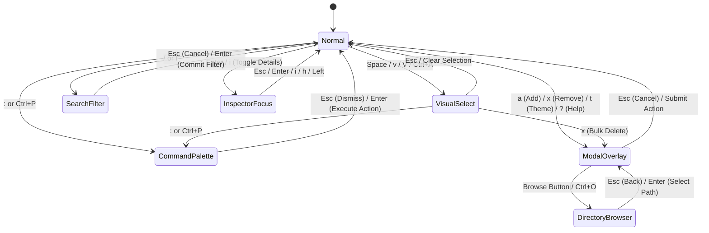
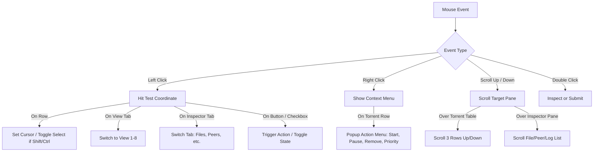

# Next-Generation rTorrent/rstorrent UI — Controls, Keybindings & Interaction Specification

> **Component:** UI Controls, Keybindings, Modal Overlays & Mouse Interaction System  
> **Target:** `rt-tui` / `rt-tui-client` (Rust + Ratatui + Crossterm)  
> **Status:** Architecture Design Document & Specification  
> **Version:** 2.0-PROPOSED  

---

## 1. Executive Summary & Philosophy

Traditional rTorrent (ncurses C++) was a pioneer in terminal torrent management, but its 20-year-old UX paradigm carries crippling ergonomic flaws for modern terminal workflows:
- **Terminal Collisions:** Heavy reliance on `Ctrl+S` (which triggers terminal `XOFF` software flow control, locking the terminal) and `Ctrl+Q` (`XON`), causing remote SSH sessions to appear frozen.
- **Accidental Exits & Destructive Commands:** `Ctrl+D` ambiguously stops downloads or deletes them depending on prior state; `Ctrl+K` kills without preview; `Ctrl+C` abruptly closes the app.
- **Zero Discoverability:** Unlabeled single-letter keystrokes and cryptic status characters (`[CLOSED]`, `D:  0.0 K`, `U:  0.0 K`) with no built-in discoverability or fuzzy command searching.
- **Single-Item Friction:** Managing multiple torrents requires cumbersome repetitive key presses without visual multi-selection.

### Modern Design Manifesto (Lazygit + Helix + Btop + K9s)
The new Rust UI is designed around five core interaction tenets:
1. **Dual Navigation Parity:** Full Vim-style modal muscle memory (`j`/`k`/`h`/`l`, `g`/`G`, `Ctrl+U`/`Ctrl+D`, `/`) alongside zero-configuration standard cursor keys (Arrows, `PageUp`/`PageDown`, `Home`/`End`, `Enter`, `Esc`).
2. **Context-Sensitive Ergonomics:** Single-key actions in Normal mode (`s` start, `p` pause, `x` remove, `+`/`-` priority, `r` recheck), with multi-selection (`Space`, `Ctrl+A`) extending actions seamlessly to batch operations.
3. **Focus-Trapped Overlays & Modals:** Rich floating dialogs for high-impact actions (Add Torrent, Safe Remove Confirmation, Command Palette, Live Theme Picker, Help Cheatsheet) with clear Escape hatches.
4. **First-Class Mouse Interaction:** Click-to-focus, click-to-select, scroll-wheel lists, interactive buttons/checkboxes, and right-click context menus.
5. **Dynamic Self-Documenting Footer:** The bottom status bar adaptively reveals available shortcuts based on the current mode and active selection.

---

## 2. Interaction Modes & Finite State Machine (FSM)

The UI operates as a deterministic, strictly typed state machine. At any point in time, user input is routed through the active mode's key handler.



### Mode Descriptions

| Mode | Trigger | Purpose | Primary Controls |
|---|---|---|---|
| **Normal** | Default | Single-torrent inspection, navigation, quick toggles | `j`/`k`, Arrows, `s`, `p`, `x`, `+`/`-`, `1`-`8`, `[`/`]` |
| **Visual Select** | `Space`, `v`, `Ctrl+A` | Multi-item selection for atomic batch operations | `Space` toggle, `*` invert, `s` start all, `p` pause all, `x` delete all, `Esc` exit |
| **Search / Filter** | `/` or `f` | Real-time fuzzy filtering of active view list | Text typing, `Backspace`, `Ctrl+U` clear, `Enter` lock, `Esc` cancel |
| **Command Palette** | `:` or `Ctrl+P` | Fuzzy search for all app actions, settings & commands | Text typing, `Up`/`Down`, `Enter` run, `Esc` close |
| **Modal Overlay** | `a`, `x`, `t`, `?`, etc. | Focus-trapped interactive dialogs with inputs & buttons | `Tab`/`Shift+Tab` field cycle, `Space` toggle checkbox, `Enter` submit, `Esc` cancel |
| **Inspector Focus** | `Enter` or `i` | Deep navigation inside Details tabs (Files, Peers, Trackers, Chunks) | `h`/`l` tab cycle, `j`/`k` item select, `Space` file priority, `Esc` return to table |

---

## 3. Comprehensive Keybinding Specifications

### 3.1. Global Keybindings (Active Across All Base Views)

| Key (Vim / Primary) | Key (Standard / Alt) | Action | Category | Description |
|---|---|---|---|---|
| `:` | `Ctrl+P` | `OpenCommandPalette` | Palette | Opens spotlight fuzzy command finder |
| `?` | `F1` | `OpenHelpModal` | Help | Opens searchable shortcut cheatsheet |
| `t` | `S` | `OpenThemePicker` | Theme | Opens live-previewing color theme selector |
| `q` | `Ctrl+Q` | `PromptQuit` | Session | Clean exit confirmation modal (or instant exit if configured) |
| `Ctrl+C` | — | `ForceQuitOrCancel` | Session | Cancels active modal/filter, or prompts exit in Normal mode |
| `1` | — | `SwitchView(All)` | View | Jump to View 1: All torrents |
| `2` | — | `SwitchView(Downloading)` | View | Jump to View 2: Downloading |
| `3` | — | `SwitchView(Seeding)` | View | Jump to View 3: Seeding |
| `4` | — | `SwitchView(Active)` | View | Jump to View 4: Active (transferring) |
| `5` | — | `SwitchView(Paused)` | View | Jump to View 5: Paused / Stopped |
| `6` | — | `SwitchView(Complete)` | View | Jump to View 6: Complete |
| `7` | — | `SwitchView(Error)` | View | Jump to View 7: Errors / Check failed |
| `8` | — | `SwitchView(Hashing)` | View | Jump to View 8: Checking / Hashing |
| `Tab` | — | `NextPanelOrTab` | Layout | Cycle focus between Main Table, Inspector, and Tabs |
| `Shift+Tab` | — | `PrevPanelOrTab` | Layout | Reverse cycle focus |
| `H` / `L` | `Ctrl+Left` / `Ctrl+Right` | `PrevView` / `NextView` | View | Cycle sequentially through views 1-8 |

### 3.2. Normal Mode Navigation & Torrent Actions

| Key (Vim Style) | Key (Cursor Style) | Action | Description |
|---|---|---|---|
| `j` | `Down` | `CursorDown` | Move selection cursor down one row |
| `k` | `Up` | `CursorUp` | Move selection cursor up one row |
| `g` | `Home` | `CursorTop` | Jump directly to first torrent |
| `G` | `End` | `CursorBottom` | Jump directly to last torrent |
| `Ctrl+D` | `PageDown` | `PageDown` | Jump half/full page down |
| `Ctrl+U` | `PageUp` | `PageUp` | Jump half/full page up |
| `s` | — | `StartTorrent` | Resume/start selected torrent |
| `p` | — | `PauseTorrent` | Pause/stop selected torrent |
| `x` | `Delete` | `OpenRemoveModal` | Open safe removal confirmation dialog |
| `+` | `=` | `PriorityUp` | Increase priority (`Off` → `Low` → `Normal` → `High`) |
| `-` | `_` | `PriorityDown` | Decrease priority (`High` → `Normal` → `Low` → `Off`) |
| `r` | — | `RecheckHash` | Force re-verification of downloaded pieces |
| `a` | `Ctrl+N` | `OpenAddModal` | Open "Add Torrent / Magnet" dialog |
| `o` | `Ctrl+O` | `OpenChangeDirModal` | Change download destination directory |
| `Enter` / `i` | `Right` | `ToggleInspector` | Open or focus Torrent Details / Inspector split pane |
| `m` | — | `ToggleSequential` | Toggle sequential piece download (for streaming preview) |
| `c` | — | `CopyMagnetOrHash` | Copy info-hash or magnet link to system clipboard |
| `/` | `f` | `OpenSearchFilter` | Open live filter bar at the top/bottom |

### 3.3. Selection & Visual Mode (`Space`, `v`, `Ctrl+A`)

Pressing `Space` toggles the current row's selection marker and places the UI in **Visual Select Mode**. The footer immediately reflects multi-item state.

| Key | Action | Description |
|---|---|---|
| `Space` | `ToggleSelectAndDown` | Toggle selection checkmark `[x]` on row and advance cursor |
| `v` / `V` | `ToggleSelectOnly` | Toggle selection without advancing cursor |
| `Ctrl+A` | `SelectAll` | Select all torrents matching the current view/filter |
| `*` | `InvertSelection` | Invert current selection across visible list |
| `Esc` | `ClearSelection` | Deselect all and return to Normal mode |
| `s` | `BulkStart` | Resume all selected torrents in parallel |
| `p` | `BulkPause` | Pause all selected torrents in parallel |
| `x` / `Delete` | `BulkRemoveModal` | Open batch delete confirmation for all selected torrents |
| `+` / `-` | `BulkPriority` | Raise/lower priority for all selected torrents |
| `r` | `BulkRecheck` | Queue hash check for all selected torrents |

### 3.4. Speed Throttling & Global Bandwidth Controls

Instant, fine-grained speed adjustments without navigating menus:

| Key | Action | Step Value | Description |
|---|---|---|---|
| `[` | `DownloadThrottleDown` | `- 50 KB/s` (or `- 10%`) | Decrease global download limit |
| `]` | `DownloadThrottleUp` | `+ 50 KB/s` (or `+ 10%`) | Increase global download limit |
| `{` | `UploadThrottleDown` | `- 50 KB/s` (or `- 10%`) | Decrease global upload limit |
| `}` | `UploadThrottleUp` | `+ 50 KB/s` (or `+ 10%`) | Increase global upload limit |
| `Ctrl+[` | `FineDownloadDown` | `- 10 KB/s` | Fine-step download decrease |
| `Ctrl+]` | `FineDownloadUp` | `+ 10 KB/s` | Fine-step download increase |
| `0` | `ToggleUncapped` | Toggle Max | Toggle between capped speed profile and unlimited |
| `\` | `OpenThrottleModal` | Numeric prompt | Direct text entry for download & upload rate limits |

### 3.5. Inspector / Details Panel Navigation

When the Details panel is open and focused:

| Key | Action | Description |
|---|---|---|
| `h` / `l` or `[` / `]` | `CycleInspectorTab` | Switch between tabs: `Files` \| `Peers` \| `Trackers` \| `Chunks` \| `Bandwidth Graph` \| `Log` |
| `j` / `k` (Arrows) | `NavigateDetailsList` | Navigate file tree, peer list, or log history |
| `Space` (in Files tab) | `CycleFilePriority` | Cycle focused file: `Don't Download` (0%) → `Normal` → `High` |
| `d` (in Files tab) | `ExcludeFile` | Mark file as `Skip / Do Not Download` |
| `d` (in Peers tab) | `SnubOrDisconnectPeer` | Disconnect / snub unresponsive peer |
| `r` (in Trackers tab) | `AnnounceTracker` | Force immediate tracker re-announce |
| `Esc` or `Enter` or `i` | `ExitInspector` | Shift focus back to main torrent table |

---

## 4. Modal Dialogs & Overlays Specifications

Modals render centered on top of a shaded backdrop. When a modal opens:
- Focus is trapped strictly within the modal ring.
- Underlying background table is dimmed or styled with low-contrast colors.
- `Esc` always acts as an immediate safe cancel / dismiss.
- Key navigation within dialogs adheres to standard desktop ergonomics: `Tab`/`Shift+Tab` or `Up`/`Down` between fields.

---

### 4.1. Command Palette (`:` or `Ctrl+P`)

A high-performance fuzzy command finder (like VS Code / Helix / Raycast) allowing instant execution of any action.

```
┌───────────────────────── Command Palette ─────────────────────────┐
│ ❯ throt                                                           │
├───────────────────────────────────────────────────────────────────┤
│ [Bandwidth] Set Global Download Limit ...                    [ \ ]│
│ [Bandwidth] Set Global Upload Limit ...                      [ \ ]│
│ [Bandwidth] Toggle Unlimited Bandwidth                       [ 0 ]│
│ [Torrent]   Throttle Selected Torrent ...                         │
├───────────────────────────────────────────────────────────────────┤
│ ↑↓: Select  │  Enter: Execute  │  Esc: Close                      │
└───────────────────────────────────────────────────────────────────┘
```

#### Interactions & Logic:
- **Trigger:** `:` or `Ctrl+P`.
- **Input:** Live typing matches against command titles, descriptions, and category tags using a fast Myers/Smith-Waterman fuzzy match algorithm (e.g. `nucleo-matcher` or `sublime_fuzzy`).
- **Shortcuts Displayed:** Shows the direct physical shortcut key on the far right as a passive learning aid.
- **`Enter`:** Immediately executes the highlighted command and dismisses the palette.
- **`Esc`:** Cancels without executing.

---

### 4.2. Add Torrent / Magnet Modal (`a` or `Ctrl+N`)

A clean, comprehensive dialog supporting URLs, magnet links, and local `.torrent` file paths with directory browsing.

```
┌───────────────────────── Add New Torrent ─────────────────────────┐
│ Source URL / Magnet / .torrent path:                              │
│ ┌───────────────────────────────────────────────────────────────┐ │
│ │ magnet:?xt=urn:btih:3b34c38d4a7b4588e...                      │ │
│ └───────────────────────────────────────────────────────────────┘ │
│ Destination Directory:                                            │
│ ┌──────────────────────────────────────────────┬────────────────┐ │
│ │ /mnt/storage/downloads/linux-distros         │ [ 📁 Browse ]  │ │
│ └──────────────────────────────────────────────┴────────────────┘ │
│                                                                   │
│ Options:                                                          │
│   [x] Start torrent immediately                                   │
│   [ ] Sequential download (order pieces for streaming)           │
│   [ ] Skip initial hash check                                     │
│                                                                   │
│ Initial Priority:  [ Normal    ▾ ]                                │
│ Tags / Labels:     [ linux, iso  ]                                │
├───────────────────────────────────────────────────────────────────┤
│    [ ✓ Add Torrent (Enter) ]            [ Cancel (Esc) ]          │
└───────────────────────────────────────────────────────────────────┘
```

#### Interactions & Logic:
- **Field Traversal:** `Tab` moves forward, `Shift+Tab` moves backward.
- **Checkbox Toggle:** `Space` toggles focused checkbox.
- **Priority Dropdown:** `Left`/`Right` or `Space` cycles priority (`Low`, `Normal`, `High`).
- **File Browser (`[Browse]` or `Ctrl+O`):** Spawns the in-terminal folder navigation modal to visually pick a download directory.
- **Auto-Paste:** If clipboard contains a valid `magnet:?` or `.torrent` URL when opened, automatically populate the source input!
- **Submit (`Enter`):** Dispatches `TuiAction::Load` with destination path, priority, and tags.

---

### 4.3. Remove Torrent Confirmation Modal (`x` or `Delete`)

Prevents catastrophic accidental deletion while making the process fast and explicit.

```
┌─────────────────── Confirm Torrent Removal ───────────────────────┐
│                                                                   │
│   Are you sure you want to remove 3 torrents?                     │
│                                                                   │
│   • ubuntu-24.04-desktop-amd64.iso (4.2 GB)                       │
│   • debian-12.5.0-netinst.iso (650 MB)                            │
│   • archlinux-2024.03.01-x86_64.iso (950 MB)                      │
│                                                                   │
│   Total disk space: 5.8 GB                                        │
│                                                                   │
│   Removal Option:                                                 │
│   (•) Remove from session only (keep data files on disk)          │
│   ( ) PERMANENTLY DELETE data files from disk                     │
│                                                                   │
├───────────────────────────────────────────────────────────────────┤
│    [ Cancel (Esc) ]             [ ⚠ Confirm Remove (Enter) ]      │
└───────────────────────────────────────────────────────────────────┘
```

#### Safety Rules:
- **Default Focus:** Placed on `[ Cancel (Esc) ]` by default to prevent accidental double-tap deletions.
- **Destructive Deletion:** Choosing `( ) PERMANENTLY DELETE` changes the confirm button style to pulsating **Bold Red Alert** and requires pressing `Space` or `2` to toggle radio button.
- **Safety Threshold:** If selected files exceed 100 GB and delete files is checked, an extra confirmation prompt or typing confirmation ("YES") can be enabled via settings.

---

### 4.4. Shortcuts Cheatsheet Modal (`?` or `F1`)

A categorized, two-column interactive modal.

```
┌─────────────────────── Keyboard Shortcuts ────────────────────────┐
│ Filter shortcuts: [                     ]                         │
├────────────────────────────────┬──────────────────────────────────┤
│ NAVIGATION                     │ TORRENT CONTROL                  │
│  j / Down      Cursor down     │  s            Start / Resume     │
│  k / Up        Cursor up       │  p            Pause / Stop       │
│  g / Home      Top of list     │  x / Del      Remove torrent     │
│  G / End       Bottom of list  │  + / -        Priority up / down │
│  Ctrl+D / PgDn Half page down  │  r            Recheck hash       │
│  Ctrl+U / PgUp Half page up    │  a            Add torrent/magnet │
│  Enter / i     Inspect details │  o            Change save dir    │
├────────────────────────────────┼──────────────────────────────────┤
│ SELECTION & BULK               │ VIEWS & BANDWIDTH                │
│  Space         Toggle select   │  1 .. 8       Switch views       │
│  Ctrl+A        Select all      │  [ / ]        Download speed ±   │
│  *             Invert selection│  { / }        Upload speed ±     │
│  Esc           Clear selection │  0            Toggle uncapped    │
├────────────────────────────────┴──────────────────────────────────┤
│ Type to filter  │  Tab: Switch column  │  Esc / ?: Close          │
└───────────────────────────────────────────────────────────────────┘
```

---

### 4.5. Settings & Theme Picker Modal (`t` or `S`)

Allows instant theme switching with a live split-screen preview.

```
┌────────────────────── Color Theme & Settings ─────────────────────┐
│ Select Theme:                  │ Live Preview:                    │
│   Catppuccin Mocha             │ ┌──────────────────────────────┐ │
│ ❯ Tokyo Night (Active)         │ │[2] Downloading       12.4 MB/s││
│   Nord Dark                    │ │Ubuntu 24.04   ██████░░ 72%   ││
│   Gruvbox Dark                 │ │Peers: 42(110)  ETA: 4m 12s   ││
│   Dracula                      │ └──────────────────────────────┘ │
│   Cyberpunk Neon               │ Primary:   #7aa2f7 [Blue]        │
│   Classic 16-Color Terminal    │ Secondary: #bb9af7 [Purple]      │
│   Monochrome Minimal           │ Background:#1a1b26 [Dark Navy]   │
├────────────────────────────────┴──────────────────────────────────┤
│ ↑↓: Select & Preview  │  Enter: Apply & Save  │  Esc: Revert      │
└───────────────────────────────────────────────────────────────────┘
```

#### Interactions:
- Pressing `Up`/`Down` instantly paints the UI with the highlighted theme without closing the dialog (live preview).
- `Enter` commits the theme to `config.toml`.
- `Esc` immediately reverts back to the original theme.

---

## 5. Mouse & Pointer Interactions

The interface fully enables Crossterm mouse capture (`EnableMouseCapture`) for intuitive desktop-like operation.



### Detailed Mouse Mapping Table

| Mouse Action | Screen Area | Target Element | Action Performed |
|---|---|---|---|
| **Left Click** | Main Table | Torrent row | Set active cursor to clicked torrent |
| **Left Click** | Main Table | Checkbox column `[ ]` | Toggle visual multi-selection for that item |
| **Ctrl + Left Click** | Main Table | Any row | Multi-select toggle without clearing other selections |
| **Shift + Left Click** | Main Table | Any row | Range selection from active cursor to clicked row |
| **Double Click** | Main Table | Torrent row | Toggle Inspector details pane open/closed |
| **Right Click** | Main Table | Torrent row | Open floating popup context menu at mouse coordinates |
| **Scroll Wheel Up/Down** | Main Table | Anywhere in table | Scroll table list by 3 rows |
| **Left Click** | Top Tab Bar | View tab (`[1] All`, etc.) | Switch active view directly |
| **Left Click** | Inspector Header| Sub-tabs (`Files`, `Peers`) | Switch inspector view |
| **Scroll Wheel** | Inspector Pane | Files / Peers / Log | Scroll content inside the inspector independently |
| **Left Click** | Modal Overlay | Buttons (`[OK]`, `[Cancel]`)| Trigger button action |
| **Left Click** | Modal Overlay | Checkbox `[x]` / Radio `(•)`| Toggle option state |
| **Left Click** | Modal Overlay | Backdrop outside modal | Safe dismissal (equivalent to `Esc`) |

---

## 6. Real-Time Dynamic Footer Bar

The bottom bar adapts dynamically to the current mode, providing an effortless learning curve:

### In Normal Mode (Single item focused):
```
[1] All: 14 torrents │ <s> Start  <p> Pause  <x> Delete  <+-> Priority  <i> Details  <?> Help  <:> Cmd
```

### In Visual Select Mode (3 torrents selected):
```
[Visual Select: 3 items (8.4 GB)] │ <s> Start (3)  <p> Pause (3)  <x> Delete (3)  <Space> Deselect  <Esc> Clear
```

### In Search Filter Mode:
```
Filter (Fuzzy): debian_                        [3 matches] │ <Enter> Lock filter  <Esc> Clear & Exit
```

### In Details / Inspector Mode:
```
[Inspector: Ubuntu 24.04] Files (1/3) │ <Space> Toggle Priority  <d> Skip File  <Tab> Peers  <Esc> Back
```

---

## 7. Rust Architecture & Implementation Blueprint

### 7.1. State Machine & Event Types

```rust
// In `crates/rt-tui-client/src/interaction/mode.rs`

#[derive(Debug, Clone, PartialEq, Eq)]
pub enum AppMode {
    Normal,
    VisualSelect {
        selected_hashes: std::collections::HashSet<String>,
        anchor_index: usize,
    },
    SearchFilter {
        query: String,
        cursor_pos: usize,
    },
    CommandPalette {
        query: String,
        selected_index: usize,
    },
    Modal(Box<ModalState>),
    InspectorFocus {
        active_tab: InspectorTab,
    },
}

#[derive(Debug, Clone, PartialEq, Eq)]
pub enum InspectorTab {
    Files,
    Peers,
    Trackers,
    Chunks,
    BandwidthGraph,
    Log,
}

#[derive(Debug, Clone, PartialEq, Eq)]
pub enum ModalState {
    AddTorrent(AddTorrentModalState),
    RemoveConfirm(RemoveConfirmModalState),
    ThemePicker(ThemePickerModalState),
    HelpCheatsheet(HelpModalState),
    DirectoryBrowser(DirectoryBrowserModalState),
    SetThrottle(SetThrottleModalState),
}
```

### 7.2. High-Performance Input Event Dispatcher

```rust
// In `crates/rt-tui-client/src/interaction/dispatcher.rs`

use crossterm::event::{Event as CrosstermEvent, KeyCode, KeyEvent, KeyModifiers, MouseEvent, MouseEventKind};
use crate::actions::TuiAction;
use super::mode::AppMode;

pub struct InteractionDispatcher {
    // Configurable keymap overrides (Vim vs Standard vs Custom)
    vim_keys_enabled: bool,
}

impl InteractionDispatcher {
    pub fn new(vim_keys_enabled: bool) -> Self {
        Self { vim_keys_enabled }
    }

    pub fn dispatch(
        &self,
        event: CrosstermEvent,
        mode: &AppMode,
    ) -> Option<TuiAction> {
        match event {
            CrosstermEvent::Key(key) => self.handle_key(key, mode),
            CrosstermEvent::Mouse(mouse) => self.handle_mouse(mouse, mode),
            CrosstermEvent::Resize(cols, rows) => Some(TuiAction::Resize { cols, rows }),
            _ => None,
        }
    }

    fn handle_key(&self, key: KeyEvent, mode: &AppMode) -> Option<TuiAction> {
        // Universal cancel / escape across any mode
        if key.code == KeyCode::Esc {
            return Some(TuiAction::CancelOrBack);
        }

        match mode {
            AppMode::Normal => self.handle_normal_key(key),
            AppMode::VisualSelect { .. } => self.handle_visual_key(key),
            AppMode::SearchFilter { .. } => self.handle_search_key(key),
            AppMode::CommandPalette { .. } => self.handle_palette_key(key),
            AppMode::Modal(modal) => self.handle_modal_key(key, modal),
            AppMode::InspectorFocus { .. } => self.handle_inspector_key(key),
        }
    }

    fn handle_mouse(&self, mouse: MouseEvent, mode: &AppMode) -> Option<TuiAction> {
        match mouse.kind {
            MouseEventKind::ScrollDown => Some(TuiAction::ScrollDown(3)),
            MouseEventKind::ScrollUp => Some(TuiAction::ScrollUp(3)),
            MouseEventKind::Down(button) => Some(TuiAction::Click {
                x: mouse.column,
                y: mouse.row,
                button,
            }),
            _ => None,
        }
    }
}
```

### 7.3. Rect Hit-Testing for Mouse Coordinates

Ratatui layouts generate deterministic `Rect` coordinates during render. By caching the active layout rectangles (`view_tabs_rect`, `table_rect`, `inspector_rect`, `modal_rect`) in the UI frame state:
- When a mouse event occurs at `(column, row)`, a single lightweight pass over cached `Rect::contains(Position { x, y })` identifies the clicked widget with zero allocation.
- Right-clicks on rows instantly calculate the selected row index via `(mouse.row - table_rect.y) / row_height + scroll_offset`.

---

## 8. Summary of Benefits Over Legacy rTorrent

| Dimension | Legacy rTorrent (C++) | New Rust TUI (Proposed) |
|---|---|---|
| **Terminal Compatibility** | Freezes with `Ctrl+S` / `Ctrl+Q` (XON/XOFF) | Clean single keys (`s`, `p`, `x`), zero terminal collisions |
| **Navigation Paradigm** | Cryptic arrow keys & `^N`/`^P` | Full dual paradigm: Seamless Vim (`j/k/h/l`, `g/G`) + Standard cursors |
| **Multi-Selection** | Non-existent; single torrent operations only | Full Visual mode (`Space`, `Ctrl+A`), atomic batch operations |
| **Command Discovery** | Undocumented single keys; must read man page | Fuzzy Command Palette (`:`, `Ctrl+P`) & interactive shortcuts cheatsheet (`?`) |
| **Destructive Safeguards** | Ambiguous `^D` closes or permanently deletes | Dedicated confirmation modal with disk size preview and default cancel focus |
| **Mouse Support** | None | Full mouse click, drag, scroll wheel, and right-click context menus |
| **Customization** | Hardcoded or static colors | Live Theme Picker (`t`) with real-time preview across 8+ modern palettes |
| **Speed Throttles** | Complex command line syntax | Instant single keys (`[`/`]`, `{`/`}`, `0`) and quick numeric modal |

---
*End of Specification.*
