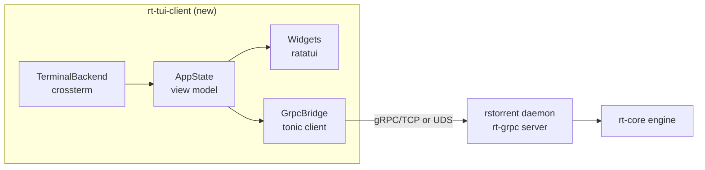
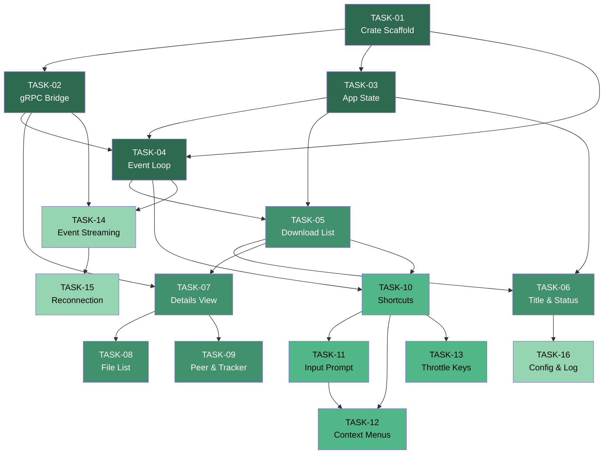
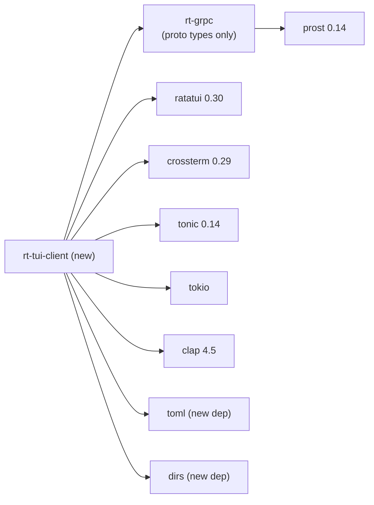

# TUI Implementation Plan — Standalone gRPC TUI Client

> **Standard:** ECC Planner & TDD Guide v2  
> **Created:** 2026-10-27  
> **Project:** rstorrent — ratatui + gRPC standalone TUI  
> **Crate:** `rt-tui-client` (new binary crate)

---

## Executive Summary

This plan defines the implementation of a **standalone TUI binary** (`rstorrent-tui`)
that connects to the `rstorrent` daemon via **gRPC** (tonic) and renders the full
rTorrent-compatible interface using **ratatui + crossterm**.

The current `rt-tui` crate is tightly coupled to `rt-core` types through
`Arc<RwLock<DownloadList>>`, `Arc<RwLock<ViewManager>>`, and `Arc<Mutex<RootUI>>`.
The new client replaces that coupling with gRPC calls to `TorrentService`,
`SystemService`, and `CommandService` (already defined in
`crates/rt-grpc/proto/rstorrent.proto`), enabling remote operation and process
isolation.

### Architecture Diagram



### Phasing

| Phase | Tasks | Focus |
|-------|-------|-------|
| **I — Foundation** | TASK-01 … TASK-04 | Crate scaffold, gRPC client, app state, event loop |
| **II — Core Views** | TASK-05 … TASK-09 | Download list, details, file/peer/tracker views |
| **III — Interaction** | TASK-10 … TASK-13 | Keyboard shortcuts, input/prompt, menus, throttle |
| **IV — Polish** | TASK-14 … TASK-16 | Streaming events, reconnection, config/theming |

---

## Global ECC Activation

> [!IMPORTANT]
> Every task in this plan MUST activate these ECC skills and rules before
> implementation begins.

```yaml
ecc:
  skills:
    - skills/tdd-workflow          # Enforces RED → GREEN → REFACTOR cycle
  rules:
    - rules/rust/coding-style.md   # No unwrap(), explicit error handling
    - rules/rust/patterns.md       # Bounded channels, explicit matches, Arc discipline
  build:
    command: "scripts/remote-ci.sh"  # All cargo commands via remote builder
```

**Invariants enforced by `rules/rust/coding-style.md`:**
- Zero `unwrap()` / `expect()` in production code (only in `#[cfg(test)]`)
- All `match` arms explicit — no wildcard catch-alls that hide new variants
- `?` operator for fallible paths with typed errors (`thiserror`)

**Invariants enforced by `rules/rust/patterns.md`:**
- Bounded channels only (`tokio::sync::mpsc::channel(N)`, never unbounded)
- `Arc<RwLock<T>>` for shared read-heavy state, `Arc<Mutex<T>>` for mutation-heavy
- No blocking operations on the async runtime (use `spawn_blocking`)

---

## TASK-01 — Crate Scaffold & CLI

**ID:** `TASK-01`  
**Phase:** I — Foundation  
**Depends on:** —  
**Estimated effort:** S (1–2h)

### ECC Activation

```yaml
skills: [skills/tdd-workflow]
rules: [rules/rust/coding-style.md, rules/rust/patterns.md]
```

### User Journey

> As a user, I run `rstorrent-tui --endpoint localhost:5000` and the binary
> parses CLI arguments, validates the endpoint, and exits cleanly with a
> "connected" or "connection refused" message.

### Acceptance Criteria

- [ ] New workspace member `crates/rt-tui-client` exists with `Cargo.toml`
- [ ] Binary target `rstorrent-tui` is produced
- [ ] CLI parsed with `clap`: `--endpoint` (TCP or Unix socket), `--theme`, `--refresh-ms`
- [ ] Entry point creates a tokio runtime and exits cleanly
- [ ] `scripts/remote-ci.sh check --workspace --all-targets` passes

### TDD Specification

**RED phase — write first, must fail:**

```rust
// crates/rt-tui-client/tests/test_cli.rs
#[test]
fn cli_parses_tcp_endpoint() {
    let cli = Cli::try_parse_from(["rstorrent-tui", "--endpoint", "localhost:5000"])
        .expect("valid CLI");
    assert_eq!(cli.endpoint, "localhost:5000");
    assert_eq!(cli.refresh_ms, 500); // default
}

#[test]
fn cli_parses_unix_socket_endpoint() {
    let cli = Cli::try_parse_from([
        "rstorrent-tui", "--endpoint", "unix:///tmp/rstorrent.sock"
    ]).expect("valid CLI");
    assert_eq!(cli.endpoint, "unix:///tmp/rstorrent.sock");
}

#[test]
fn cli_rejects_missing_endpoint() {
    let result = Cli::try_parse_from(["rstorrent-tui"]);
    assert!(result.is_err());
}
```

**GREEN phase — minimal implementation:**

- `crates/rt-tui-client/Cargo.toml` with `clap`, `tokio`, `tonic`, `ratatui`, `crossterm`
- `crates/rt-tui-client/src/main.rs` — tokio entry
- `crates/rt-tui-client/src/cli.rs` — `Cli` struct with `clap::Parser`

### Affected Files

| Action | Path |
|--------|------|
| CREATE | `crates/rt-tui-client/Cargo.toml` |
| CREATE | `crates/rt-tui-client/src/main.rs` |
| CREATE | `crates/rt-tui-client/src/cli.rs` |
| CREATE | `crates/rt-tui-client/src/lib.rs` |
| CREATE | `crates/rt-tui-client/tests/test_cli.rs` |
| MODIFY | `Cargo.toml` (workspace members) |

### Execution Hook

```bash
scripts/remote-ci.sh test -p rt-tui-client --test test_cli
```

---

## TASK-02 — gRPC Client Bridge

**ID:** `TASK-02`  
**Phase:** I — Foundation  
**Depends on:** TASK-01  
**Estimated effort:** M (2–4h)

### ECC Activation

```yaml
skills: [skills/tdd-workflow]
rules: [rules/rust/coding-style.md, rules/rust/patterns.md]
```

### User Journey

> As the TUI event loop, I call `GrpcBridge::list_torrents("main")` and receive
> a `Vec<TorrentSummary>` or a typed `BridgeError::ConnectionLost`.

### Acceptance Criteria

- [ ] `GrpcBridge` wraps tonic-generated clients for all 3 services
- [ ] Connects to TCP (`host:port`) or Unix domain socket (`unix:///path`)
- [ ] All methods return `Result<T, BridgeError>` — never panic
- [ ] Bounded timeout on every RPC call (configurable, default 5s)
- [ ] `BridgeError` enum distinguishes `ConnectionLost`, `Timeout`, `ServerError`, `InvalidResponse`

### TDD Specification

**RED phase:**

```rust
// crates/rt-tui-client/tests/test_grpc_bridge.rs
#[tokio::test]
async fn bridge_returns_connection_error_when_server_unreachable() {
    let bridge = GrpcBridge::connect("http://127.0.0.1:1", Duration::from_millis(100))
        .await;
    assert!(matches!(bridge, Err(BridgeError::ConnectionLost(_))));
}

#[tokio::test]
async fn bridge_error_display_includes_endpoint() {
    let err = BridgeError::ConnectionLost("http://127.0.0.1:1".into());
    let msg = format!("{}", err);
    assert!(msg.contains("127.0.0.1:1"));
}

#[test]
fn bridge_error_variants_are_exhaustive() {
    // Ensure all variants are matchable without wildcard
    let err = BridgeError::Timeout(Duration::from_secs(5));
    match err {
        BridgeError::ConnectionLost(_) => {}
        BridgeError::Timeout(_) => {}
        BridgeError::ServerError { .. } => {}
        BridgeError::InvalidResponse(_) => {}
    }
}
```

**GREEN phase:**

- `crates/rt-tui-client/src/bridge.rs` — `GrpcBridge` struct + `BridgeError` enum
- Use tonic-generated `TorrentServiceClient`, `SystemServiceClient`, `CommandServiceClient`
- Endpoint parsing: `http://` for TCP, `unix://` for UDS (tonic `Endpoint::from_shared`)

### Affected Files

| Action | Path |
|--------|------|
| CREATE | `crates/rt-tui-client/src/bridge.rs` |
| CREATE | `crates/rt-tui-client/tests/test_grpc_bridge.rs` |
| MODIFY | `crates/rt-tui-client/src/lib.rs` |
| MODIFY | `crates/rt-tui-client/Cargo.toml` (add `rt-grpc` dep) |

### Execution Hook

```bash
scripts/remote-ci.sh test -p rt-tui-client --test test_grpc_bridge
```

---

## TASK-03 — Application State (View Model)

**ID:** `TASK-03`  
**Phase:** I — Foundation  
**Depends on:** TASK-02  
**Estimated effort:** M (3–4h)

### ECC Activation

```yaml
skills: [skills/tdd-workflow]
rules: [rules/rust/coding-style.md, rules/rust/patterns.md]
```

### User Journey

> As the rendering layer, I read `AppState.torrents` and `AppState.session_stats`
> to draw the UI. As the polling loop, I call `AppState::refresh(&bridge)` and the
> state updates atomically.

### Acceptance Criteria

- [ ] `AppState` holds: `Vec<TorrentViewModel>`, `SessionStats`, `ConnectionStatus`, `ActiveView`, `FocusIndex`
- [ ] `TorrentViewModel` maps from proto `TorrentSummary` with formatted rates/sizes
- [ ] `SessionStats` maps from proto `SessionStatsResponse`
- [ ] `refresh()` fetches from bridge and updates state; errors transition to `ConnectionStatus::Disconnected`
- [ ] State is not behind `Arc`/`Mutex` — owned by the single-threaded TUI loop

### TDD Specification

**RED phase:**

```rust
// crates/rt-tui-client/tests/test_app_state.rs
#[test]
fn torrent_view_model_formats_rate_zero_as_dash() {
    let summary = make_proto_summary(0, 0); // helpers
    let vm = TorrentViewModel::from_proto(&summary);
    assert_eq!(vm.down_rate_display, "   0.0 KB");
}

#[test]
fn torrent_view_model_formats_megabyte_rate() {
    let summary = make_proto_summary(1_500_000, 0);
    let vm = TorrentViewModel::from_proto(&summary);
    assert!(vm.down_rate_display.contains("1.4"));
}

#[test]
fn app_state_focus_clamps_to_bounds() {
    let mut state = AppState::new();
    state.torrents = vec![make_vm(), make_vm()];
    state.focus_down();
    state.focus_down();
    state.focus_down(); // past end
    assert_eq!(state.focus_index, 1);
}

#[test]
fn app_state_focus_home_goes_to_zero() {
    let mut state = AppState::new();
    state.torrents = vec![make_vm(), make_vm(), make_vm()];
    state.focus_index = 2;
    state.focus_home();
    assert_eq!(state.focus_index, 0);
}
```

**GREEN phase:**

- `crates/rt-tui-client/src/state.rs` — `AppState`, `TorrentViewModel`, `SessionStats`, `ConnectionStatus`
- Pure data transformations, no async

### Affected Files

| Action | Path |
|--------|------|
| CREATE | `crates/rt-tui-client/src/state.rs` |
| CREATE | `crates/rt-tui-client/tests/test_app_state.rs` |
| MODIFY | `crates/rt-tui-client/src/lib.rs` |

### Execution Hook

```bash
scripts/remote-ci.sh test -p rt-tui-client --test test_app_state
```

---

## TASK-04 — Event Loop & Terminal Backend

**ID:** `TASK-04`  
**Phase:** I — Foundation  
**Depends on:** TASK-01, TASK-03  
**Estimated effort:** M (3–5h)

### ECC Activation

```yaml
skills: [skills/tdd-workflow]
rules: [rules/rust/coding-style.md, rules/rust/patterns.md]
```

### User Journey

> As a user, I start `rstorrent-tui --endpoint localhost:5000` and see a TUI
> that enters raw mode, renders frames at the configured refresh rate, processes
> key events, and restores the terminal on `^Q`.

### Acceptance Criteria

- [ ] `App` struct owns: `AppState`, `GrpcBridge`, tick interval, terminal backend
- [ ] Event loop: `poll terminal events` → `dispatch to state` → `poll gRPC refresh` → `render`
- [ ] Terminal enters raw mode + alternate screen on start, restores on exit/panic
- [ ] Bounded event queue with resize coalescing (reuse `EventQueueConfig` pattern)
- [ ] `^Q` sets `should_quit = true`; double `^Q` exits immediately
- [ ] Panic hook restores terminal before aborting

### TDD Specification

**RED phase:**

```rust
// crates/rt-tui-client/tests/test_event_loop.rs
#[test]
fn app_quits_on_ctrl_q() {
    let mut app = App::new_headless(AppState::new()); // no terminal
    app.handle_key(KeyCode::Char('q'), KeyModifiers::CONTROL);
    assert!(app.should_quit);
}

#[test]
fn app_double_ctrl_q_sets_force_quit() {
    let mut app = App::new_headless(AppState::new());
    app.handle_key(KeyCode::Char('q'), KeyModifiers::CONTROL);
    app.handle_key(KeyCode::Char('q'), KeyModifiers::CONTROL);
    assert!(app.force_quit);
}

#[test]
fn app_resize_updates_state_dimensions() {
    let mut app = App::new_headless(AppState::new());
    app.handle_resize(120, 40);
    assert_eq!(app.state.terminal_cols, 120);
    assert_eq!(app.state.terminal_rows, 40);
}
```

**GREEN phase:**

- `crates/rt-tui-client/src/app.rs` — `App` struct, `new()`, `new_headless()`, `run()`, `handle_key()`
- `crates/rt-tui-client/src/terminal.rs` — enter/leave raw mode, panic hook setup
- `crates/rt-tui-client/src/main.rs` — wire `App::run()`

### Affected Files

| Action | Path |
|--------|------|
| CREATE | `crates/rt-tui-client/src/app.rs` |
| CREATE | `crates/rt-tui-client/src/terminal.rs` |
| CREATE | `crates/rt-tui-client/tests/test_event_loop.rs` |
| MODIFY | `crates/rt-tui-client/src/main.rs` |
| MODIFY | `crates/rt-tui-client/src/lib.rs` |

### Execution Hook

```bash
scripts/remote-ci.sh test -p rt-tui-client --test test_event_loop
```

---

## TASK-05 — Download List Widget

**ID:** `TASK-05`  
**Phase:** II — Core Views  
**Depends on:** TASK-03, TASK-04  
**Estimated effort:** M (3–5h)

### ECC Activation

```yaml
skills: [skills/tdd-workflow]
rules: [rules/rust/coding-style.md, rules/rust/patterns.md]
```

### User Journey

> As a user, I see the torrent list with: name, size, progress bar, down/up
> rate, state, ratio. I navigate with Up/Down/PgUp/PgDn/Home/End and the
> focused row is highlighted.

### Acceptance Criteria

- [ ] `DownloadListWidget` implements `ratatui::Widget`
- [ ] Columns: name, size, done%, progress bar, ↓ rate, ↑ rate, state, ratio
- [ ] Focus row highlighted with `Style::new().reversed()`
- [ ] Scrolling viewport with PgUp/PgDn, Home/End
- [ ] Empty list shows "No torrents" centered message
- [ ] Column widths adapt to terminal width (minimum viable at 60 cols)

### TDD Specification

**RED phase:**

```rust
// crates/rt-tui-client/tests/test_download_list_widget.rs
#[test]
fn renders_empty_list_message() {
    let state = AppState::new();
    let widget = DownloadListWidget::new(&state);
    let mut buf = Buffer::empty(Rect::new(0, 0, 80, 24));
    widget.render(Rect::new(0, 0, 80, 24), &mut buf);
    let text = buffer_to_string(&buf);
    assert!(text.contains("No torrents"));
}

#[test]
fn renders_torrent_name_and_state() {
    let mut state = AppState::new();
    state.torrents.push(make_vm_with_name("ubuntu-26.04.iso"));
    let widget = DownloadListWidget::new(&state);
    let mut buf = Buffer::empty(Rect::new(0, 0, 80, 24));
    widget.render(Rect::new(0, 0, 80, 24), &mut buf);
    let text = buffer_to_string(&buf);
    assert!(text.contains("ubuntu-26.04.iso"));
}

#[test]
fn focus_row_is_highlighted() {
    let mut state = AppState::new();
    state.torrents = vec![make_vm(), make_vm()];
    state.focus_index = 1;
    let widget = DownloadListWidget::new(&state);
    let mut buf = Buffer::empty(Rect::new(0, 0, 80, 5));
    widget.render(Rect::new(0, 0, 80, 5), &mut buf);
    // Row 1 (0-indexed data row 1) should have Reversed modifier
    let cell = buf.cell((0, 2)).expect("cell exists");
    assert!(cell.modifier.contains(Modifier::REVERSED));
}
```

**GREEN phase:**

- `crates/rt-tui-client/src/widgets/download_list.rs`
- `crates/rt-tui-client/src/widgets/mod.rs`

### Affected Files

| Action | Path |
|--------|------|
| CREATE | `crates/rt-tui-client/src/widgets/mod.rs` |
| CREATE | `crates/rt-tui-client/src/widgets/download_list.rs` |
| CREATE | `crates/rt-tui-client/tests/test_download_list_widget.rs` |
| MODIFY | `crates/rt-tui-client/src/lib.rs` |

### Execution Hook

```bash
scripts/remote-ci.sh test -p rt-tui-client --test test_download_list_widget
```

---

## TASK-06 — Title Bar & Status Bar Widgets

**ID:** `TASK-06`  
**Phase:** II — Core Views  
**Depends on:** TASK-03, TASK-05  
**Estimated effort:** S (1–2h)

### ECC Activation

```yaml
skills: [skills/tdd-workflow]
rules: [rules/rust/coding-style.md, rules/rust/patterns.md]
```

### User Journey

> As a user, I see the top bar with "rstorrent v0.16.1 — [main] 5 torrents"
> and the bottom bar with throttle up/down rates, listen port, and connection status.

### Acceptance Criteria

- [ ] `TitleBarWidget` renders: client version, active view name, torrent count
- [ ] `StatusBarWidget` renders: ↑/↓ global rate, ↑/↓ throttle limits, listen port, connection indicator
- [ ] Connection status: 🟢 connected / 🔴 disconnected / 🟡 reconnecting
- [ ] Widgets adapt to narrow terminals (hide less important fields first)

### TDD Specification

**RED phase:**

```rust
// crates/rt-tui-client/tests/test_bars.rs
#[test]
fn title_bar_shows_view_name_and_count() {
    let mut state = AppState::new();
    state.active_view = "main".to_string();
    state.torrents = vec![make_vm(); 3];
    let widget = TitleBarWidget::new(&state);
    let mut buf = Buffer::empty(Rect::new(0, 0, 80, 1));
    widget.render(Rect::new(0, 0, 80, 1), &mut buf);
    let text = buffer_to_string(&buf);
    assert!(text.contains("main"));
    assert!(text.contains("3"));
}

#[test]
fn status_bar_shows_connection_indicator() {
    let mut state = AppState::new();
    state.connection_status = ConnectionStatus::Connected;
    let widget = StatusBarWidget::new(&state);
    let mut buf = Buffer::empty(Rect::new(0, 0, 80, 1));
    widget.render(Rect::new(0, 0, 80, 1), &mut buf);
    let text = buffer_to_string(&buf);
    // Connected indicator present
    assert!(text.contains("●") || text.contains("⬤") || text.contains("[OK]"));
}
```

**GREEN phase:**

- `crates/rt-tui-client/src/widgets/title_bar.rs`
- `crates/rt-tui-client/src/widgets/status_bar.rs`

### Affected Files

| Action | Path |
|--------|------|
| CREATE | `crates/rt-tui-client/src/widgets/title_bar.rs` |
| CREATE | `crates/rt-tui-client/src/widgets/status_bar.rs` |
| CREATE | `crates/rt-tui-client/tests/test_bars.rs` |
| MODIFY | `crates/rt-tui-client/src/widgets/mod.rs` |

### Execution Hook

```bash
scripts/remote-ci.sh test -p rt-tui-client --test test_bars
```

---

## TASK-07 — Torrent Details View

**ID:** `TASK-07`  
**Phase:** II — Core Views  
**Depends on:** TASK-02, TASK-05  
**Estimated effort:** M (3–4h)

### ECC Activation

```yaml
skills: [skills/tdd-workflow]
rules: [rules/rust/coding-style.md, rules/rust/patterns.md]
```

### User Journey

> As a user, I press Right (or `l` in vi mode) on a torrent to enter details.
> I see tabs: Info / Files / Peers / Trackers / Chunks. I navigate tabs with
> Left/Right or 1-5. I press Left (or `h`) to return to the list.

### Acceptance Criteria

- [ ] `DetailsWidget` fetches `TorrentDetails` via bridge on activation
- [ ] Tab bar at top: `[1:Info] [2:Files] [3:Peers] [4:Trackers] [5:Chunks]`
- [ ] Info tab: hash, name, size, piece length/count, directory, message, private, connection_seed, throttle
- [ ] Navigation: Left/`h`/`^B` returns to download list
- [ ] Tab switching: number keys 1–5, Left/Right arrows in tab bar

### TDD Specification

**RED phase:**

```rust
// crates/rt-tui-client/tests/test_details_widget.rs
#[test]
fn details_info_tab_shows_hash_and_name() {
    let details = make_torrent_details("abc123def", "test.torrent");
    let state = DetailsState::from_proto(&details);
    let widget = DetailsWidget::new(&state, DetailTab::Info);
    let mut buf = Buffer::empty(Rect::new(0, 0, 80, 20));
    widget.render(Rect::new(0, 0, 80, 20), &mut buf);
    let text = buffer_to_string(&buf);
    assert!(text.contains("abc123def"));
    assert!(text.contains("test.torrent"));
}

#[test]
fn tab_navigation_cycles_correctly() {
    let mut state = DetailsState::from_proto(&make_torrent_details("h", "t"));
    assert_eq!(state.active_tab, DetailTab::Info);
    state.next_tab();
    assert_eq!(state.active_tab, DetailTab::Files);
    state.next_tab();
    assert_eq!(state.active_tab, DetailTab::Peers);
}
```

**GREEN phase:**

- `crates/rt-tui-client/src/widgets/details.rs` — `DetailsWidget`, `DetailsState`, `DetailTab`
- `crates/rt-tui-client/src/state.rs` — add `DetailsState` to `AppState`

### Affected Files

| Action | Path |
|--------|------|
| CREATE | `crates/rt-tui-client/src/widgets/details.rs` |
| CREATE | `crates/rt-tui-client/tests/test_details_widget.rs` |
| MODIFY | `crates/rt-tui-client/src/state.rs` |
| MODIFY | `crates/rt-tui-client/src/widgets/mod.rs` |

### Execution Hook

```bash
scripts/remote-ci.sh test -p rt-tui-client --test test_details_widget
```

---

## TASK-08 — File List View

**ID:** `TASK-08`  
**Phase:** II — Core Views  
**Depends on:** TASK-07  
**Estimated effort:** M (3–4h)

### ECC Activation

```yaml
skills: [skills/tdd-workflow]
rules: [rules/rust/coding-style.md, rules/rust/patterns.md]
```

### User Journey

> As a user, I select the Files tab in details and see per-file: path, size,
> completed %, priority. I can change priority with Space/`*` and navigate
> with Up/Down.

### Acceptance Criteria

- [ ] `FileListWidget` renders file rows from `TorrentDetails.files`
- [ ] Columns: index, path, size, completed, priority (Off/Normal/High)
- [ ] Priority display: `Off`/`Normal`/`High` with color coding
- [ ] Focus/selection with Up/Down/PgUp/PgDn
- [ ] Space/`*` cycles priority via `CommandService.Execute("f.priority.set", ...)`
- [ ] Directory rows (if multiple files share prefix) are synthetic/non-actionable

### TDD Specification

**RED phase:**

```rust
// crates/rt-tui-client/tests/test_file_list_widget.rs
#[test]
fn renders_file_path_and_priority() {
    let files = vec![
        make_file_info(0, "data/file1.txt", 1024, 512, 1),
        make_file_info(1, "data/file2.txt", 2048, 2048, 2),
    ];
    let state = FileListState::from_proto(&files);
    let widget = FileListWidget::new(&state);
    let mut buf = Buffer::empty(Rect::new(0, 0, 80, 10));
    widget.render(Rect::new(0, 0, 80, 10), &mut buf);
    let text = buffer_to_string(&buf);
    assert!(text.contains("file1.txt"));
    assert!(text.contains("file2.txt"));
}

#[test]
fn priority_cycles_through_values() {
    let mut state = FileListState::from_proto(&vec![
        make_file_info(0, "a.txt", 100, 0, 1),
    ]);
    // Priority: 0=off, 1=normal, 2=high → cycles
    assert_eq!(state.next_priority(0), 2); // normal → high
    assert_eq!(state.next_priority_from(2), 0); // high → off
    assert_eq!(state.next_priority_from(0), 1); // off → normal
}
```

**GREEN phase:**

- `crates/rt-tui-client/src/widgets/file_list.rs`
- `crates/rt-tui-client/src/state.rs` — `FileListState`

### Affected Files

| Action | Path |
|--------|------|
| CREATE | `crates/rt-tui-client/src/widgets/file_list.rs` |
| CREATE | `crates/rt-tui-client/tests/test_file_list_widget.rs` |
| MODIFY | `crates/rt-tui-client/src/state.rs` |
| MODIFY | `crates/rt-tui-client/src/widgets/mod.rs` |

### Execution Hook

```bash
scripts/remote-ci.sh test -p rt-tui-client --test test_file_list_widget
```

---

## TASK-09 — Peer & Tracker List Views

**ID:** `TASK-09`  
**Phase:** II — Core Views  
**Depends on:** TASK-07  
**Estimated effort:** M (3–4h)

### ECC Activation

```yaml
skills: [skills/tdd-workflow]
rules: [rules/rust/coding-style.md, rules/rust/patterns.md]
```

### User Journey

> As a user, I select the Peers tab and see: address, client, ↑/↓ rate,
> encrypted flag. In the Trackers tab: URL, enabled, group, last event.

### Acceptance Criteria

- [ ] `PeerListWidget` renders from `TorrentDetails.peers`
- [ ] Columns: address, peer_id/client, ↑ rate, ↓ rate, 🔒 encrypted
- [ ] `TrackerListWidget` renders from `TorrentDetails.trackers`
- [ ] Columns: group, URL, enabled, index
- [ ] Both lists support focus navigation
- [ ] Empty list shows "No peers" / "No trackers"

### TDD Specification

**RED phase:**

```rust
// crates/rt-tui-client/tests/test_peer_tracker_widget.rs
#[test]
fn peer_list_renders_address_and_encryption() {
    let peers = vec![make_peer_info("1.2.3.4:6881", true)];
    let state = PeerListState::from_proto(&peers);
    let widget = PeerListWidget::new(&state);
    let mut buf = Buffer::empty(Rect::new(0, 0, 80, 10));
    widget.render(Rect::new(0, 0, 80, 10), &mut buf);
    let text = buffer_to_string(&buf);
    assert!(text.contains("1.2.3.4"));
}

#[test]
fn tracker_list_renders_url_and_group() {
    let trackers = vec![make_tracker_info(0, "http://tracker.example.com/announce", true, 0)];
    let state = TrackerListState::from_proto(&trackers);
    let widget = TrackerListWidget::new(&state);
    let mut buf = Buffer::empty(Rect::new(0, 0, 80, 10));
    widget.render(Rect::new(0, 0, 80, 10), &mut buf);
    let text = buffer_to_string(&buf);
    assert!(text.contains("tracker.example.com"));
}

#[test]
fn empty_peer_list_shows_message() {
    let state = PeerListState::from_proto(&[]);
    let widget = PeerListWidget::new(&state);
    let mut buf = Buffer::empty(Rect::new(0, 0, 80, 10));
    widget.render(Rect::new(0, 0, 80, 10), &mut buf);
    let text = buffer_to_string(&buf);
    assert!(text.contains("No peers"));
}
```

**GREEN phase:**

- `crates/rt-tui-client/src/widgets/peer_list.rs`
- `crates/rt-tui-client/src/widgets/tracker_list.rs`

### Affected Files

| Action | Path |
|--------|------|
| CREATE | `crates/rt-tui-client/src/widgets/peer_list.rs` |
| CREATE | `crates/rt-tui-client/src/widgets/tracker_list.rs` |
| CREATE | `crates/rt-tui-client/tests/test_peer_tracker_widget.rs` |
| MODIFY | `crates/rt-tui-client/src/state.rs` |
| MODIFY | `crates/rt-tui-client/src/widgets/mod.rs` |

### Execution Hook

```bash
scripts/remote-ci.sh test -p rt-tui-client --test test_peer_tracker_widget
```

---

## TASK-10 — Keyboard Shortcuts & Torrent Actions

**ID:** `TASK-10`  
**Phase:** III — Interaction  
**Depends on:** TASK-04, TASK-05  
**Estimated effort:** L (4–6h)

### ECC Activation

```yaml
skills: [skills/tdd-workflow]
rules: [rules/rust/coding-style.md, rules/rust/patterns.md]
```

### User Journey

> As a user, I press `^S` to start, `^D` to stop/erase, `^K` to close,
> `^R` to hash-check, `+`/`-` for priority, `I` to toggle ignore, matching
> the classic rTorrent workflow.

### Acceptance Criteria

- [ ] `KeyHandler` dispatches download-list shortcuts to `bridge.control_torrent()`
- [ ] `^S` → `TorrentAction::Start`
- [ ] `^D` → if active: `Stop`; if stopped: `RemoveTorrent`
- [ ] `^K` → `Execute("d.ignore_commands.set", 1)` + `Stop` + `Close`
- [ ] `^R` → `Execute("d.complete.set", 0)` + `CheckHash`
- [ ] `+`/`-` → `SetTorrentPriority` cycling 0→1→2→3→0
- [ ] `I` → toggle `d.ignore_commands` via `Execute`
- [ ] `Backspace` → open load prompt; `^X` → open command prompt
- [ ] All actions require a focused torrent; no-op on empty list

### TDD Specification

**RED phase:**

```rust
// crates/rt-tui-client/tests/test_shortcuts.rs
#[test]
fn ctrl_s_produces_start_action() {
    let mut app = App::new_headless(state_with_torrents(1));
    let action = app.handle_key(KeyCode::Char('s'), KeyModifiers::CONTROL);
    assert_eq!(action, Some(TuiAction::ControlTorrent {
        hash: "abc123".to_string(),
        action: TorrentAction::Start,
    }));
}

#[test]
fn ctrl_d_on_active_produces_stop() {
    let mut app = App::new_headless(state_with_active_torrent());
    let action = app.handle_key(KeyCode::Char('d'), KeyModifiers::CONTROL);
    assert_eq!(action, Some(TuiAction::ControlTorrent {
        hash: "abc123".to_string(),
        action: TorrentAction::Stop,
    }));
}

#[test]
fn ctrl_d_on_stopped_produces_remove() {
    let mut app = App::new_headless(state_with_stopped_torrent());
    let action = app.handle_key(KeyCode::Char('d'), KeyModifiers::CONTROL);
    assert!(matches!(action, Some(TuiAction::RemoveTorrent { .. })));
}

#[test]
fn plus_cycles_priority_up() {
    let mut app = App::new_headless(state_with_priority(2));
    let action = app.handle_key(KeyCode::Char('+'), KeyModifiers::NONE);
    assert_eq!(action, Some(TuiAction::SetPriority {
        hash: "abc123".to_string(),
        priority: 3,
    }));
}

#[test]
fn shortcuts_noop_on_empty_list() {
    let mut app = App::new_headless(AppState::new());
    let action = app.handle_key(KeyCode::Char('s'), KeyModifiers::CONTROL);
    assert_eq!(action, None);
}
```

**GREEN phase:**

- `crates/rt-tui-client/src/actions.rs` — `TuiAction` enum
- `crates/rt-tui-client/src/key_handler.rs` — dispatching logic
- `crates/rt-tui-client/src/app.rs` — wire action execution via bridge

### Affected Files

| Action | Path |
|--------|------|
| CREATE | `crates/rt-tui-client/src/actions.rs` |
| CREATE | `crates/rt-tui-client/src/key_handler.rs` |
| CREATE | `crates/rt-tui-client/tests/test_shortcuts.rs` |
| MODIFY | `crates/rt-tui-client/src/app.rs` |
| MODIFY | `crates/rt-tui-client/src/lib.rs` |

### Execution Hook

```bash
scripts/remote-ci.sh test -p rt-tui-client --test test_shortcuts
```

---

## TASK-11 — Input Prompt & Command Execution

**ID:** `TASK-11`  
**Phase:** III — Interaction  
**Depends on:** TASK-10  
**Estimated effort:** M (3–4h)

### ECC Activation

```yaml
skills: [skills/tdd-workflow]
rules: [rules/rust/coding-style.md, rules/rust/patterns.md]
```

### User Journey

> As a user, I press `^X` and a command prompt appears at the bottom.
> I type `d.priority.set=3`, press Enter, and the command executes via gRPC.
> I press Backspace to load a torrent by path.

### Acceptance Criteria

- [ ] `InputWidget` renders a single-line input at the bottom of the screen
- [ ] Prompt modes: `Command` (`^X`), `LoadStart` (Backspace), `LoadNormal` (Enter from load), `Filter` (`/`)
- [ ] Text editing: cursor movement (Left/Right/Home/End), delete, backspace, insert
- [ ] `Enter` submits; `Escape`/`^G` cancels
- [ ] Command submission: `bridge.execute(CommandRequest { command, args, ... })`
- [ ] Error display in status bar on failure
- [ ] Input history (Up/Down) with bounded size

### TDD Specification

**RED phase:**

```rust
// crates/rt-tui-client/tests/test_input_widget.rs
#[test]
fn input_accepts_and_returns_text() {
    let mut input = InputState::new(PromptMode::Command);
    input.insert('d');
    input.insert('.');
    input.insert('s');
    assert_eq!(input.text(), "d.s");
}

#[test]
fn input_cursor_movement() {
    let mut input = InputState::new(PromptMode::Command);
    input.set_text("hello");
    input.move_home();
    assert_eq!(input.cursor_pos(), 0);
    input.move_end();
    assert_eq!(input.cursor_pos(), 5);
}

#[test]
fn input_escape_clears_and_returns_none() {
    let mut input = InputState::new(PromptMode::Command);
    input.set_text("test");
    let result = input.handle_key(KeyCode::Esc, KeyModifiers::NONE);
    assert_eq!(result, InputResult::Cancelled);
}

#[test]
fn input_enter_returns_submitted_text() {
    let mut input = InputState::new(PromptMode::Command);
    input.set_text("d.start=");
    let result = input.handle_key(KeyCode::Enter, KeyModifiers::NONE);
    assert_eq!(result, InputResult::Submitted("d.start=".into()));
}

#[test]
fn input_history_navigates() {
    let mut input = InputState::new(PromptMode::Command);
    input.add_history("first");
    input.add_history("second");
    input.handle_key(KeyCode::Up, KeyModifiers::NONE);
    assert_eq!(input.text(), "second");
    input.handle_key(KeyCode::Up, KeyModifiers::NONE);
    assert_eq!(input.text(), "first");
}
```

**GREEN phase:**

- `crates/rt-tui-client/src/widgets/input.rs` — `InputWidget`, `InputState`, `InputResult`, `PromptMode`
- Wire into `App::handle_key` for mode switching

### Affected Files

| Action | Path |
|--------|------|
| CREATE | `crates/rt-tui-client/src/widgets/input.rs` |
| CREATE | `crates/rt-tui-client/tests/test_input_widget.rs` |
| MODIFY | `crates/rt-tui-client/src/app.rs` |
| MODIFY | `crates/rt-tui-client/src/state.rs` |
| MODIFY | `crates/rt-tui-client/src/widgets/mod.rs` |

### Execution Hook

```bash
scripts/remote-ci.sh test -p rt-tui-client --test test_input_widget
```

---

## TASK-12 — Context Menus

**ID:** `TASK-12`  
**Phase:** III — Interaction  
**Depends on:** TASK-10, TASK-11  
**Estimated effort:** M (2–4h)

### ECC Activation

```yaml
skills: [skills/tdd-workflow]
rules: [rules/rust/coding-style.md, rules/rust/patterns.md]
```

### User Journey

> As a user, I press `m` on a torrent and a context menu appears with:
> Start, Stop, Close, Check Hash, Set Priority, etc. I navigate with
> Up/Down and press Enter to execute.

### Acceptance Criteria

- [ ] `MenuWidget` renders as a popup overlay
- [ ] Menu entries: label, action, enabled flag
- [ ] Navigation: Up/Down, Enter to execute, Escape to close
- [ ] Disabled entries visible but not selectable
- [ ] Action execution through the same `TuiAction` dispatch path
- [ ] Menu adapts to available screen height

### TDD Specification

**RED phase:**

```rust
// crates/rt-tui-client/tests/test_menu_widget.rs
#[test]
fn menu_renders_entries() {
    let entries = vec![
        MenuEntry::new("Start", TuiAction::ControlTorrent { .. }, true),
        MenuEntry::new("Stop", TuiAction::ControlTorrent { .. }, true),
        MenuEntry::new("Remove + Data", TuiAction::RemoveTorrent { .. }, false),
    ];
    let state = MenuState::new(entries);
    let widget = MenuWidget::new(&state);
    let mut buf = Buffer::empty(Rect::new(0, 0, 40, 10));
    widget.render(Rect::new(0, 0, 40, 10), &mut buf);
    let text = buffer_to_string(&buf);
    assert!(text.contains("Start"));
    assert!(text.contains("Stop"));
}

#[test]
fn menu_skips_disabled_on_enter() {
    let entries = vec![
        MenuEntry::new("Disabled", TuiAction::Noop, false),
        MenuEntry::new("Enabled", TuiAction::Noop, true),
    ];
    let mut state = MenuState::new(entries);
    state.select(0); // on disabled
    let result = state.activate();
    assert_eq!(result, None); // disabled, no action
}

#[test]
fn menu_escape_closes() {
    let mut state = MenuState::new(vec![MenuEntry::new("A", TuiAction::Noop, true)]);
    let result = state.handle_key(KeyCode::Esc, KeyModifiers::NONE);
    assert_eq!(result, MenuResult::Closed);
}
```

**GREEN phase:**

- `crates/rt-tui-client/src/widgets/menu.rs`
- `crates/rt-tui-client/src/state.rs` — `MenuState` in `AppState`

### Affected Files

| Action | Path |
|--------|------|
| CREATE | `crates/rt-tui-client/src/widgets/menu.rs` |
| CREATE | `crates/rt-tui-client/tests/test_menu_widget.rs` |
| MODIFY | `crates/rt-tui-client/src/state.rs` |
| MODIFY | `crates/rt-tui-client/src/app.rs` |
| MODIFY | `crates/rt-tui-client/src/widgets/mod.rs` |

### Execution Hook

```bash
scripts/remote-ci.sh test -p rt-tui-client --test test_menu_widget
```

---

## TASK-13 — Throttle Controls & Keyboard Layouts

**ID:** `TASK-13`  
**Phase:** III — Interaction  
**Depends on:** TASK-10  
**Estimated effort:** M (2–3h)

### ECC Activation

```yaml
skills: [skills/tdd-workflow]
rules: [rules/rust/coding-style.md, rules/rust/patterns.md]
```

### User Journey

> As a user with `keys.layout=qwerty`, I press `a`/`z` for small upload
> throttle changes, `s`/`x` for medium, `d`/`c` for large. Uppercase
> letters control download throttle. With `keys.layout=dvorak`, the keys
> remap accordingly.

### Acceptance Criteria

- [ ] `ThrottleKeyMap` maps layout name → (upload_keys, download_keys) × (small, medium, large)
- [ ] Supported layouts: `qwerty`, `azerty`, `qwertz`, `dvorak`
- [ ] Step sizes configurable (default: small=1KB, medium=5KB, large=50KB)
- [ ] Throttle adjustments saturate at 0 (never negative)
- [ ] Changes dispatched via `CommandService.Execute("throttle.global_up.max_rate.set", ...)`

### TDD Specification

**RED phase:**

```rust
// crates/rt-tui-client/tests/test_throttle.rs
#[test]
fn qwerty_layout_maps_a_to_upload_small_up() {
    let map = ThrottleKeyMap::new("qwerty");
    let action = map.lookup('a');
    assert_eq!(action, Some(ThrottleAction::UploadUp(StepSize::Small)));
}

#[test]
fn qwerty_layout_maps_uppercase_a_to_download_small_up() {
    let map = ThrottleKeyMap::new("qwerty");
    let action = map.lookup('A');
    assert_eq!(action, Some(ThrottleAction::DownloadUp(StepSize::Small)));
}

#[test]
fn dvorak_layout_maps_semicolon_to_upload_small_down() {
    let map = ThrottleKeyMap::new("dvorak");
    let action = map.lookup(';');
    assert_eq!(action, Some(ThrottleAction::UploadDown(StepSize::Small)));
}

#[test]
fn throttle_adjustment_saturates_at_zero() {
    let mut throttle_up: u64 = 1000; // 1 KB
    throttle_up = throttle_up.saturating_sub(5000); // medium step
    assert_eq!(throttle_up, 0);
}

#[test]
fn unknown_layout_falls_back_to_qwerty() {
    let map = ThrottleKeyMap::new("unknown_layout");
    let action = map.lookup('a');
    assert_eq!(action, Some(ThrottleAction::UploadUp(StepSize::Small)));
}
```

**GREEN phase:**

- `crates/rt-tui-client/src/throttle.rs` — `ThrottleKeyMap`, `ThrottleAction`, `StepSize`

### Affected Files

| Action | Path |
|--------|------|
| CREATE | `crates/rt-tui-client/src/throttle.rs` |
| CREATE | `crates/rt-tui-client/tests/test_throttle.rs` |
| MODIFY | `crates/rt-tui-client/src/key_handler.rs` |
| MODIFY | `crates/rt-tui-client/src/lib.rs` |

### Execution Hook

```bash
scripts/remote-ci.sh test -p rt-tui-client --test test_throttle
```

---

## TASK-14 — Event Streaming & Real-Time Updates

**ID:** `TASK-14`  
**Phase:** IV — Polish  
**Depends on:** TASK-02, TASK-04  
**Estimated effort:** M (3–5h)

### ECC Activation

```yaml
skills: [skills/tdd-workflow]
rules: [rules/rust/coding-style.md, rules/rust/patterns.md]
```

### User Journey

> As a user, I see torrent state changes in real-time without polling.
> When a torrent finishes downloading, the state updates immediately.
> Session stats (rates) update every second via streaming.

### Acceptance Criteria

- [ ] `EventSubscriber` wraps `TorrentService.StreamEvents` (server-streaming RPC)
- [ ] `StatsSubscriber` wraps `SystemService.StreamStats` (server-streaming RPC)
- [ ] Events are received on a bounded `tokio::sync::mpsc` channel (capacity: 256)
- [ ] `AppState::apply_event()` updates the torrent list incrementally
- [ ] `AppState::apply_stats()` updates session stats
- [ ] Both streams reconnect automatically on disconnect (bounded backoff)

### TDD Specification

**RED phase:**

```rust
// crates/rt-tui-client/tests/test_event_stream.rs
#[test]
fn apply_event_updates_torrent_state() {
    let mut state = AppState::new();
    state.torrents = vec![make_vm_with_hash("abc123")];

    let event = TorrentEvent {
        event_name: "event.download.finished".into(),
        hash: "abc123".into(),
        summary: Some(make_proto_summary_complete()),
        timestamp: 1234567890,
    };

    state.apply_event(&event);
    assert!(state.torrents[0].is_complete);
}

#[test]
fn apply_event_for_unknown_hash_adds_torrent() {
    let mut state = AppState::new();
    assert!(state.torrents.is_empty());

    let event = TorrentEvent {
        event_name: "event.download.inserted".into(),
        hash: "new123".into(),
        summary: Some(make_proto_summary_with_hash("new123")),
        timestamp: 1234567890,
    };

    state.apply_event(&event);
    assert_eq!(state.torrents.len(), 1);
    assert_eq!(state.torrents[0].hash, "new123");
}

#[test]
fn apply_stats_updates_rates() {
    let mut state = AppState::new();
    let stats = SessionStatsResponse {
        up_rate_bytes_per_sec: 50_000,
        down_rate_bytes_per_sec: 100_000,
        ..Default::default()
    };
    state.apply_stats(&stats);
    assert_eq!(state.session.up_rate, 50_000);
    assert_eq!(state.session.down_rate, 100_000);
}
```

**GREEN phase:**

- `crates/rt-tui-client/src/stream.rs` — `EventSubscriber`, `StatsSubscriber`
- `crates/rt-tui-client/src/state.rs` — `apply_event()`, `apply_stats()`
- `crates/rt-tui-client/src/app.rs` — integrate stream processing in event loop

### Affected Files

| Action | Path |
|--------|------|
| CREATE | `crates/rt-tui-client/src/stream.rs` |
| CREATE | `crates/rt-tui-client/tests/test_event_stream.rs` |
| MODIFY | `crates/rt-tui-client/src/state.rs` |
| MODIFY | `crates/rt-tui-client/src/app.rs` |
| MODIFY | `crates/rt-tui-client/src/lib.rs` |

### Execution Hook

```bash
scripts/remote-ci.sh test -p rt-tui-client --test test_event_stream
```

---

## TASK-15 — Reconnection & Connection Health

**ID:** `TASK-15`  
**Phase:** IV — Polish  
**Depends on:** TASK-14  
**Estimated effort:** M (2–4h)

### ECC Activation

```yaml
skills: [skills/tdd-workflow]
rules: [rules/rust/coding-style.md, rules/rust/patterns.md]
```

### User Journey

> As a user, if the daemon goes down, the TUI shows "Disconnected — retrying
> in 3s…" in the status bar. When the daemon comes back, the TUI reconnects
> automatically and resumes showing data.

### Acceptance Criteria

- [ ] `ConnectionManager` handles: `Connected` → `Disconnected` → `Reconnecting` states
- [ ] Exponential backoff: 1s → 2s → 4s → 8s → max 30s
- [ ] During `Disconnected`, all widgets show stale data with a "stale" indicator
- [ ] Status bar shows reconnection countdown
- [ ] Successful reconnect triggers a full state refresh
- [ ] Health check: periodic `GetVersion` ping (every 10s)

### TDD Specification

**RED phase:**

```rust
// crates/rt-tui-client/tests/test_reconnection.rs
#[test]
fn backoff_increases_exponentially() {
    let mut mgr = ConnectionManager::new();
    assert_eq!(mgr.next_backoff(), Duration::from_secs(1));
    mgr.record_failure();
    assert_eq!(mgr.next_backoff(), Duration::from_secs(2));
    mgr.record_failure();
    assert_eq!(mgr.next_backoff(), Duration::from_secs(4));
}

#[test]
fn backoff_caps_at_max() {
    let mut mgr = ConnectionManager::new();
    for _ in 0..10 {
        mgr.record_failure();
    }
    assert!(mgr.next_backoff() <= Duration::from_secs(30));
}

#[test]
fn successful_reconnect_resets_backoff() {
    let mut mgr = ConnectionManager::new();
    mgr.record_failure();
    mgr.record_failure();
    mgr.record_success();
    assert_eq!(mgr.next_backoff(), Duration::from_secs(1));
}

#[test]
fn state_transitions() {
    let mut mgr = ConnectionManager::new();
    assert_eq!(mgr.state(), ConnectionState::Disconnected);
    mgr.record_success();
    assert_eq!(mgr.state(), ConnectionState::Connected);
    mgr.record_failure();
    assert_eq!(mgr.state(), ConnectionState::Reconnecting);
}
```

**GREEN phase:**

- `crates/rt-tui-client/src/connection.rs` — `ConnectionManager`, `ConnectionState`
- Integrate with `App` event loop and `StatusBarWidget`

### Affected Files

| Action | Path |
|--------|------|
| CREATE | `crates/rt-tui-client/src/connection.rs` |
| CREATE | `crates/rt-tui-client/tests/test_reconnection.rs` |
| MODIFY | `crates/rt-tui-client/src/app.rs` |
| MODIFY | `crates/rt-tui-client/src/widgets/status_bar.rs` |
| MODIFY | `crates/rt-tui-client/src/lib.rs` |

### Execution Hook

```bash
scripts/remote-ci.sh test -p rt-tui-client --test test_reconnection
```

---

## TASK-16 — Configuration, Theming & Log View

**ID:** `TASK-16`  
**Phase:** IV — Polish  
**Depends on:** TASK-06  
**Estimated effort:** M (3–4h)

### ECC Activation

```yaml
skills: [skills/tdd-workflow]
rules: [rules/rust/coding-style.md, rules/rust/patterns.md]
```

### User Journey

> As a user, I configure the TUI via `~/.config/rstorrent-tui/config.toml`
> with custom colors and key bindings. I press `l` to see the log view
> with timestamped messages.

### Acceptance Criteria

- [ ] Config file: `~/.config/rstorrent-tui/config.toml` (XDG_CONFIG_HOME aware)
- [ ] Configurable: endpoint, refresh_ms, theme/colors, keys.layout
- [ ] Theme: background, foreground, highlight, progress_bar, error colors
- [ ] `LogWidget` renders timestamped log messages with scrollback
- [ ] `l` key toggles log view; Space in log view returns to download list
- [ ] Log captures: connection events, command results, errors

### TDD Specification

**RED phase:**

```rust
// crates/rt-tui-client/tests/test_config.rs
#[test]
fn default_config_is_valid() {
    let cfg = TuiConfig::default();
    assert_eq!(cfg.refresh_ms, 500);
    assert_eq!(cfg.keys_layout, "qwerty");
}

#[test]
fn config_parses_from_toml() {
    let toml = r#"
        endpoint = "localhost:5001"
        refresh_ms = 1000
        keys_layout = "dvorak"

        [theme]
        background = "black"
        highlight = "yellow"
    "#;
    let cfg: TuiConfig = toml::from_str(toml).expect("valid toml");
    assert_eq!(cfg.endpoint, Some("localhost:5001".into()));
    assert_eq!(cfg.refresh_ms, 1000);
    assert_eq!(cfg.keys_layout, "dvorak");
}

#[test]
fn log_widget_renders_messages() {
    let messages = vec![
        LogEntry::new("Connected to localhost:5000"),
        LogEntry::new("Torrent added: ubuntu.iso"),
    ];
    let state = LogState::new(messages);
    let widget = LogWidget::new(&state);
    let mut buf = Buffer::empty(Rect::new(0, 0, 80, 10));
    widget.render(Rect::new(0, 0, 80, 10), &mut buf);
    let text = buffer_to_string(&buf);
    assert!(text.contains("Connected"));
    assert!(text.contains("ubuntu.iso"));
}
```

**GREEN phase:**

- `crates/rt-tui-client/src/config.rs` — `TuiConfig` with serde
- `crates/rt-tui-client/src/widgets/log.rs` — `LogWidget`, `LogState`
- `Cargo.toml` — add `toml` and `dirs` dependencies

### Affected Files

| Action | Path |
|--------|------|
| CREATE | `crates/rt-tui-client/src/config.rs` |
| CREATE | `crates/rt-tui-client/src/widgets/log.rs` |
| CREATE | `crates/rt-tui-client/tests/test_config.rs` |
| MODIFY | `crates/rt-tui-client/src/app.rs` |
| MODIFY | `crates/rt-tui-client/src/lib.rs` |
| MODIFY | `crates/rt-tui-client/src/widgets/mod.rs` |
| MODIFY | `crates/rt-tui-client/Cargo.toml` |

### Execution Hook

```bash
scripts/remote-ci.sh test -p rt-tui-client --test test_config
```

---

## DAG (Task Dependency Graph)



> **Legend:** Dark green = Phase I, Medium green = Phase II, Light green = Phase III, Lightest = Phase IV

---

## Verification Matrix

| Task | Test File | Command |
|------|-----------|---------|
| TASK-01 | `tests/test_cli.rs` | `scripts/remote-ci.sh test -p rt-tui-client --test test_cli` |
| TASK-02 | `tests/test_grpc_bridge.rs` | `scripts/remote-ci.sh test -p rt-tui-client --test test_grpc_bridge` |
| TASK-03 | `tests/test_app_state.rs` | `scripts/remote-ci.sh test -p rt-tui-client --test test_app_state` |
| TASK-04 | `tests/test_event_loop.rs` | `scripts/remote-ci.sh test -p rt-tui-client --test test_event_loop` |
| TASK-05 | `tests/test_download_list_widget.rs` | `scripts/remote-ci.sh test -p rt-tui-client --test test_download_list_widget` |
| TASK-06 | `tests/test_bars.rs` | `scripts/remote-ci.sh test -p rt-tui-client --test test_bars` |
| TASK-07 | `tests/test_details_widget.rs` | `scripts/remote-ci.sh test -p rt-tui-client --test test_details_widget` |
| TASK-08 | `tests/test_file_list_widget.rs` | `scripts/remote-ci.sh test -p rt-tui-client --test test_file_list_widget` |
| TASK-09 | `tests/test_peer_tracker_widget.rs` | `scripts/remote-ci.sh test -p rt-tui-client --test test_peer_tracker_widget` |
| TASK-10 | `tests/test_shortcuts.rs` | `scripts/remote-ci.sh test -p rt-tui-client --test test_shortcuts` |
| TASK-11 | `tests/test_input_widget.rs` | `scripts/remote-ci.sh test -p rt-tui-client --test test_input_widget` |
| TASK-12 | `tests/test_menu_widget.rs` | `scripts/remote-ci.sh test -p rt-tui-client --test test_menu_widget` |
| TASK-13 | `tests/test_throttle.rs` | `scripts/remote-ci.sh test -p rt-tui-client --test test_throttle` |
| TASK-14 | `tests/test_event_stream.rs` | `scripts/remote-ci.sh test -p rt-tui-client --test test_event_stream` |
| TASK-15 | `tests/test_reconnection.rs` | `scripts/remote-ci.sh test -p rt-tui-client --test test_reconnection` |
| TASK-16 | `tests/test_config.rs` | `scripts/remote-ci.sh test -p rt-tui-client --test test_config` |

### Full Suite

```bash
scripts/remote-ci.sh test -p rt-tui-client
scripts/remote-ci.sh clippy --workspace --all-targets -- -D warnings
scripts/remote-ci.sh fmt --check
```

---

## Appendix A — Proto Service ↔ Task Mapping

| Proto Service | RPC | Used by Tasks |
|---------------|-----|---------------|
| `TorrentService.ListTorrents` | Fetch torrent list | TASK-03, TASK-05 |
| `TorrentService.GetTorrent` | Fetch details | TASK-07, TASK-08, TASK-09 |
| `TorrentService.ControlTorrent` | Start/Stop/Pause/Check | TASK-10 |
| `TorrentService.RemoveTorrent` | Erase torrent | TASK-10 |
| `TorrentService.SetTorrentPriority` | Priority +/- | TASK-10 |
| `TorrentService.AddTorrent` | Load from prompt | TASK-11 |
| `TorrentService.StreamEvents` | Real-time events | TASK-14 |
| `SystemService.GetVersion` | Health check | TASK-15 |
| `SystemService.GetSessionStats` | Status bar data | TASK-06 |
| `SystemService.StreamStats` | Live rate updates | TASK-14 |
| `SystemService.Shutdown` | `^Q` shutdown | TASK-04 |
| `CommandService.Execute` | Generic commands | TASK-10, TASK-11, TASK-13 |
| `CommandService.Multicall` | Batch operations | TASK-08 (file priority) |
| `CommandService.ListCommands` | Command completion | TASK-11 |

## Appendix B — New Crate Dependency Graph



> [!NOTE]
> `rt-tui-client` depends on `rt-grpc` only for the generated proto types
> (re-exported via `rt_grpc::proto`). It does **not** depend on `rt-core`,
> `rt-rpc`, or any engine crate. This ensures clean process separation.
